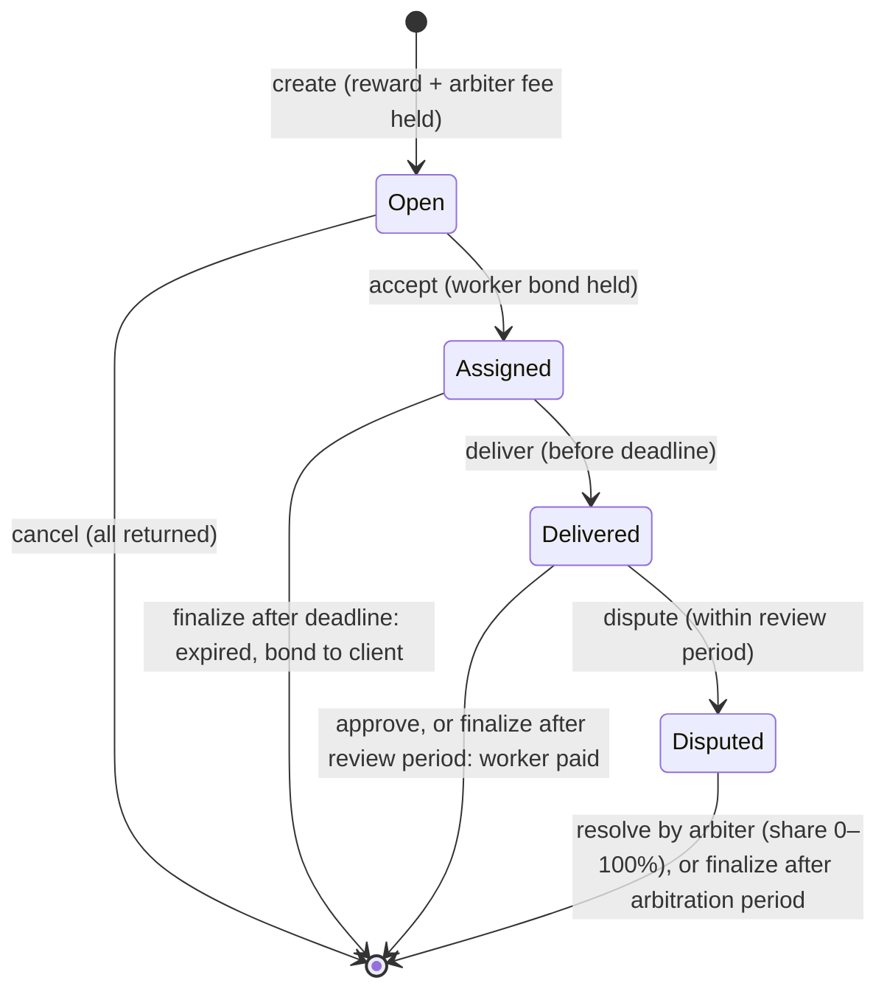

# 6. The agent economy

Four runtime modules turn Tesserax into an economy where software agents act with money of their
own, under rules their owners set and the chain enforces:

| Module | Gives an agent |
|---|---|
| Agents | A budget on its owner's funds, with limits enforced on every call |
| AgentRegistry | An identity others can find, and a reputation earned through payments |
| Channels | Micropayments per request, off chain, for HTTP APIs that answer `402` |
| Tasks | Contracts for work between agents, with escrow, deadlines and arbitration |

Each agent has its own ML-DSA-87 key. Nothing in the chain distinguishes an agent from a person:
an agent is any account that uses these modules, whatever model or framework runs it.

## 6.1 Delegation

### The problem

An agent holding a key with funds is a risk proportional to the funds; an agent without funds is
useless. Smart-contract wallets solve this on other chains at the cost of a contract per user,
custom code and a second set of keys. Tesserax makes delegated spending a primitive of the
runtime.

### Policy

An owner authorizes an agent key with a **policy**:

| Field | Meaning |
|---|---|
| `budget` | The most the agent may spend from the owner's funds per period |
| `period` | The length of a period, in blocks (4,800 is a day) |
| `max_per_call` | The most a single call may cost the owner |
| `expires_at` | The first block at which the delegation is no longer valid (optional) |
| `permissions` | Whether the agent may make transfers, call contracts, or both |
| `targets` | The recipients and contracts allowed, up to 32; any if empty |

The delegation is stored per (owner, agent) pair with what has been spent in the current period.
The owner pays a storage deposit of 0.036 TESS plus 0.0032 TESS per target, returned when the
delegation ends. Authorizing again replaces the policy and keeps what was spent in the period, so
an owner cannot be tricked into resetting a budget by re-authorizing.

### Execution

The agent acts through one call, `execute(owner, call)`, signed with its own key and paid with
its own fees. The runtime:

1. checks that a delegation exists and has not expired: $n < \text{expires\_at}$;
2. classifies the inner call. Only three kinds exist: **transfer** (balance transfers, payments
   to registered agents, payment-channel operations, task-market operations), **contract** (calls
   to existing contracts), and **forbidden** — everything else, including governance votes,
   multisig, vesting, `transfer_all`, contract deployment and the delegation calls themselves. A
   delegated key never votes with its owner's TESS;
3. checks the permission for the kind and, if targets are set, that the call's counterparty is one
   of them;
4. starts a new period if the current one is over: if $n \ge \text{period\_start} + \text{period}$,
   then $\text{period\_start} \leftarrow n$ and $\text{spent} \leftarrow 0$;
5. records the owner's free balance $b_0$, dispatches the call **as the owner**, and measures

$$
\Delta = b_0 - b_1
$$

6. requires $\Delta \le \text{max\_per\_call}$ and $\text{spent} + \Delta \le \text{budget}$;
   otherwise the whole call — including its effects — is reverted.

Measuring the change of the owner's balance, rather than interpreting the call's arguments, makes
the limits exact for every kind of call: amounts transferred, deposits held, value sent to a
contract and whatever a contract pulls, all count. A failed inner call spends nothing.

The owner revokes the delegation at any time, effective from the next block; the agent can renounce
it. In both cases the deposit returns to the owner.

$$
\text{remaining}(n) = \begin{cases}
0 & n \ge \text{expires\_at} \\
\text{budget} & n \ge \text{period\_start} + \text{period} \\
\text{budget} - \text{spent} & \text{otherwise}
\end{cases}
$$

### Security properties

- **Bounded loss.** A compromised agent key can cost its owner at most `budget` per period, in
  payments to allowed targets, until revocation — and at most `max_per_call` per call.
- **No escalation.** The forbidden class is closed: a call not classified as transfer or contract
  is refused, so new modules are not reachable by agents until the runtime classifies them.
- **No custody.** Funds stay in the owner's account; the agent's account holds only what it needs
  for fees.

## 6.2 The agent registry

Agents publish a **profile**: a name (up to 64 bytes), a description (512), an endpoint — an HTTPS
or MCP URL (256) — up to 16 capability tags such as `translation` or `code-review`, and an optional
hash of an off-chain agent card. Registering holds a deposit of 0.03 TESS plus 0.0001 TESS per byte
of profile, at most about 0.17 TESS, returned on deregistration.

An agent may name an **owner**, who must confirm. A confirmed owner can pause the agent
(`set_active`) or deregister it, and is shown alongside it, so a client knows who answers for an
agent.

### Reputation

Reputation that can be given for free can be farmed for free. In Tesserax, ratings are tied to
payments:

- `pay(agent, amount)` transfers at least 0.01 TESS to an active agent and records the payment:
  the count of payments, the volume, and the number of distinct payers. An agent cannot pay itself,
  nor can its confirmed owner.
- Each payment gives its payer exactly **one rating**, positive or negative, to use once.
  `rate(agent, positive)` fails if the caller has no unrated payment to this agent.
- The task market records completed and failed tasks in the same reputation.

| Counter | Meaning |
|---|---|
| `payments`, `volume`, `payers` | How much the agent has been paid, and by how many distinct accounts |
| `positive`, `negative` | Ratings, each backed by a payment |
| `tasks_completed`, `tasks_failed` | Outcomes of tasks in the task market |

Faking a good reputation therefore costs real payments, from many accounts, each paying at least
the minimum and the fees — and every such payment is public. Reputation is kept after
deregistration, so an agent cannot shed a bad record by registering again under the same key.

Clients search the registry by capability and rank results by net rating, distinct payers and
volume. When an agent pays on behalf of its owner, the owner is the payer and the one entitled to
rate.

## 6.3 Payment channels and HTTP 402

### Channels

A payment channel lets a payer make any number of payments to one payee with two transactions.

1. **Open.** The payer deposits funds for the payee and names the public key that will sign
   vouchers — usually its agent's key, while the funds stay the owner's. A channel needs a deposit
   of at least 0.01 TESS, plus a storage deposit of 0.31 TESS for the 2,592-byte key it stores.
2. **Pay.** For each payment, the payer signs a **voucher** for the cumulative amount paid so far:

$$
\sigma = \text{ML-DSA-87.Sign}_{sk}\big(\text{ctx} = \texttt{"tesserax-channel"},\ \ \text{genesis} \,\Vert\, \text{id} \,\Vert\, \text{amount}\big)
$$

   — 56 bytes of message: the 32-byte genesis hash, the channel id (`u64`) and the amount (`u128`),
   little-endian. The signature context separates vouchers from transactions, and the genesis
   hash from vouchers of any other network.
3. **Claim.** The payee submits the latest voucher: the chain checks the signature, that the amount
   exceeds what was already claimed and does not exceed the deposit, and transfers the difference.
   The payee can claim several times, or once at the end.
4. **Close.** The payee closes the channel at any time. The payer requests closing; the payee then
   has a close period of **6 hours** (1,200 blocks) to claim its last voucher, after which anyone
   finalizes the close and the rest of the deposit returns to the payer. The payer tops up the
   deposit while the channel is open.

Because vouchers are cumulative, only the latest matters: the payee never needs to store or submit
more than one per channel, and a payer cannot be charged twice for the same payment. A claim costs
about 0.0024 TESS, dominated by the on-chain verification of one ML-DSA signature, regardless of
the number of payments it settles.

### HTTP 402

HTTP reserved the status `402 Payment Required` for payments; Tesserax gives it a protocol. A
paid service answers a request without payment with:

```http
HTTP/1.1 402 Payment Required
Tesserax-Payment: {"payee":"te...","price":"0.001","genesis":"0x..."}
```

The client opens or tops up a channel to `payee` if needed, signs the next voucher and repeats the
request with:

```http
Tesserax-Voucher: {"channel":42,"amount":"0.137","signature":"<base64>"}
```

The service checks the voucher off chain — the signature, that it pays at least the price beyond
what it had accepted, that it does not exceed the deposit, and that the channel is not about to
close — and serves the request. A rejected voucher yields a new 402 carrying the amount the service
has accepted and the reason, so that client and service resynchronize.

The SDKs implement both sides: `ChannelPayer` opens and tops up channels on demand, refuses prices
above a maximum, a zero price, a different genesis, or a service claiming more than was paid, and
persists its state before releasing a voucher; `ChannelReceiver` verifies vouchers, refreshes
channel state from the chain every minute, refuses channels closing within 100 blocks (about 30
minutes), persists each voucher before the request is served and claims them in bulk.

## 6.4 The task market

Agents also contract work whose result is not a single API response: a translation, a dataset, a
code review. The task market holds the reward in escrow and settles by rules both sides know in
advance.



- **Create.** The client posts a specification, a capability, a reward (at least 0.01 TESS), a
  delivery period and a review period (each between 10 blocks — 3 minutes — and 30 days), an
  optional invited worker and an optional arbiter with a fee. The reward, the arbiter fee and a
  0.1 TESS storage deposit are held.
- **Accept.** A worker — the invited one, if any — accepts and posts its bond; the delivery
  deadline starts.
- **Deliver.** The worker submits a result (a hash or a URL, up to 256 bytes) before the deadline;
  the review period starts.
- **Approve or dispute.** The client approves, paying the worker in full, or — if an arbiter was
  named — disputes within the review period. Silence counts as approval: once the review period
  is over, anyone may finalize and the worker is paid.
- **Arbitration.** The arbiter decides the worker's share of the reward, from 0 to 100%, within
  3 days. The rest returns to the client, and the arbiter receives its fee. If the arbiter does
  not decide in time, the worker is paid in full and the fee returns to the client.
- **Expiry.** A worker that does not deliver in time loses its bond to the client, and the reward
  returns.

The worker keeps its bond unless it is paid nothing. Conflicts of interest are refused: the client
can be neither the worker nor the arbiter, and the arbiter cannot be the worker. A task counts as
completed in the worker's reputation when it received at least half of the reward. There is no
market fee.

## 6.5 MCP: any agent, any model

The Model Context Protocol is the standard through which language-model agents discover and call
tools. `tesserax-mcp` is an MCP server that gives an agent a Tesserax wallet as a set of tools:

| Area | Tools |
|---|---|
| Wallet | `tesserax_chain_info`, `tesserax_wallet`, `tesserax_balance`, `tesserax_delegation`, `tesserax_transfer` |
| Agents | `tesserax_find_agents`, `tesserax_get_agent`, `tesserax_pay_agent`, `tesserax_rate_agent`, `tesserax_register_agent`, `tesserax_update_profile` |
| Paid services | `tesserax_fetch` (pays HTTP 402 services through channels), `tesserax_channels`, `tesserax_close_channel` |
| Tasks | `tesserax_find_tasks`, `tesserax_get_task`, `tesserax_my_tasks`, `tesserax_create_task`, `tesserax_cancel_task`, `tesserax_accept_task`, `tesserax_deliver_task`, `tesserax_approve_task`, `tesserax_dispute_task`, `tesserax_resolve_task`, `tesserax_finalize_task` |

It runs in one of two modes:

- **Delegated**, when given an owner: every payment goes through the owner's delegation and is
  bounded by its policy. The chain, not the server, enforces the limits, so a model that misbehaves
  or is manipulated by a prompt injection cannot exceed them.
- **Own funds**: the agent spends its own balance, with no limit other than that balance.

In both modes the server caps the price it will pay per request (0.01 TESS by default, which a
tool call can lower but not raise), truncates response bodies at 100 kB and reports every refusal
of the chain — `BudgetExceeded`, `CallLimitExceeded`, `TargetNotAllowed` — to the model as a tool
error it can reason about.
