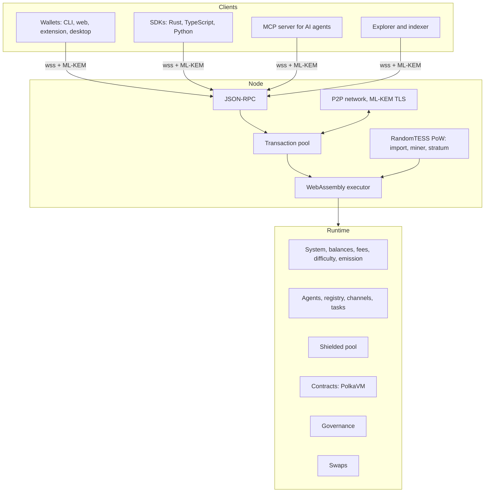

# 2. Architecture

Tesserax is an independent layer-1 chain built with the Polkadot SDK (Substrate, release
stable2606). It is not a parachain and shares no security with any other network: it has its own
proof-of-work consensus, its own validator set — the miners — and its own token. The Polkadot SDK
provides the database, the networking stack, the transaction pool, the RPC server and the FRAME
framework for the runtime; Tesserax replaces every cryptographic component that is not
post-quantum and adds its own consensus and modules.

## 2.1 The node

The node (`node/`, `consensus/pow/`) is a native binary that:

- imports blocks after checking their proof of work and executing them with the runtime;
- keeps the chain of greatest cumulative difficulty as the best chain and finalizes blocks 60 deep;
- relays blocks and transactions over a peer-to-peer network whose connections are encrypted with
  keys exchanged by ML-KEM;
- mines with a built-in RandomTESS miner, or serves block templates to external miners (XMRig and
  pools) over a stratum protocol;
- serves the JSON-RPC interface that wallets and applications use.

The node contains no business logic. Everything that defines the chain — accounts, fees, rewards,
difficulty, agents, privacy, contracts, governance — lives in the runtime.

## 2.2 The runtime

The runtime is a WebAssembly program stored on chain, executed by every node for every block. A
referendum can replace it; nodes then run the new version from the next block without being
updated themselves (chapter 10). It is composed of FRAME modules, called pallets:

| Index | Module | Role |
|---|---|---|
| 0 | System | Accounts, nonces, events, runtime upgrades |
| 1 | Timestamp | Block time, used by the difficulty adjustment |
| 2 | Difficulty | LWMA difficulty adjustment over 120 blocks |
| 3 | Balances | TESS balances, holds and freezes |
| 4 | TransactionPayment | Fees by weight and length, paid to the miner |
| 6 | Revive | Smart contracts on PolkaVM |
| 7 | Shielded | Private transfers proven with STARKs |
| 8 | Emission | Block rewards and halvings |
| 9 | Vesting | Locks released over time |
| 10 | Multisig | Multi-signature accounts, used by the foundation |
| 11 | Allocations | Team and foundation allocations at genesis |
| 12 | Agents | Delegated spending for agent keys |
| 13 | AgentRegistry | Identity, endpoints, capabilities and reputation of agents |
| 14 | Channels | Payment channels and vouchers |
| 15 | Tasks | Task market with escrow and arbitration |
| 16–22 | Governance | Preimages, scheduler, referenda, conviction voting, origins, whitelist, technical committee |
| 23 | Swaps | Atomic swaps against BTC, ETH, USDC and USDT |

Index 5 was the sudo module of the early testnet; it was removed when governance took over
(chapter 10), and the index is not reused.

### Accounts and units

- An account identifier is the BLAKE2-256 hash of an ML-DSA-87 public key (chapter 3).
- Addresses use the SS58 encoding with prefix 2261 and start with `te`.
- Balances are `u128` amounts of planck; one TESS is $10^{12}$ planck (12 decimals).
- The existential deposit is 0.001 TESS: an account below it is removed and its dust goes to the
  miner of the block.
- Block numbers and nonces are `u32`.

### Transactions

A signed transaction carries the call, the signer's public key, an ML-DSA-87 signature and the
transaction extensions: the spec and transaction versions and the genesis hash (so that a
transaction cannot be replayed on another chain or runtime), a mortality era, the nonce, the fee
payment with an optional tip, the metadata hash and weight accounting. Two kinds of calls are
valid without any signature, because a proof authorizes them instead: private transfers of the
shielded pool, authorized by their STARK, and claims of atomic swaps, authorized by the secret of
the swap. Applying a runtime upgrade that a referendum authorized is the third.

## 2.3 Clients and services

| Component | Description |
|---|---|
| `tesserax-wallet` | Command line wallet: encrypted ML-DSA accounts, transfers, agents, channels, tasks, private transfers, contracts, governance and swaps |
| Web wallet, extension, desktop | The same features in a browser, a browser extension with a provider API for web applications, and a desktop application |
| Explorer | An indexer following the chain, reorganizations included, into a database, and a web application to search it |
| Faucet | Free testnet TESS, limited per address and per IP |
| Mining pool | Stratum server for rigs, verified shares, PPLNS rewards and automatic payouts |
| RPC gateway | The public endpoint `wss://rpc.tesserax.app:21207`, with TLS 1.3 limited to ML-KEM key exchanges |
| SDKs | Rust, TypeScript and Python libraries with the same operations, ML-DSA signing included |
| MCP server | Tools for any agent speaking the Model Context Protocol |
| Miner | A build of XMRig for the `rx/tess` algorithm, CPU only, without developer fee |

All of them are open source. The node and the proof-of-work consensus are licensed under the
GPL-3.0 with the Classpath exception, like the Polkadot SDK client crates they build on; RandomTESS
keeps the BSD-3 license of RandomX; the runtime, the SDKs, the tools and the documentation are
licensed under Apache-2.0.
