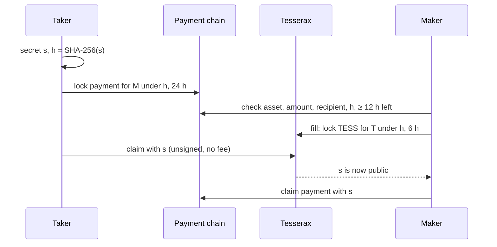

# 9. Atomic swaps

Bridges are the largest source of losses in the industry: a bridge holds the assets of one chain
and issues claims on another, and whoever controls its keys or its contract controls everything it
holds. Tesserax trades with other chains through **atomic swaps** instead. Each party keeps its own
assets, locked under the same hash on its own chain; either both sides complete, or both are
refunded. No one ever holds the other party's funds.

## 9.1 What can be traded

| Chain | Assets |
|---|---|
| Bitcoin | BTC |
| Ethereum | ETH, USDC, USDT |
| Base | ETH, USDC |
| Arbitrum | ETH, USDC, USDT |

The testnet pairs with Bitcoin testnet4 and the Sepolia test networks of the EVM chains.

## 9.2 Roles

- A **maker** posts an **offer** on Tesserax: an amount of TESS, a price in a payment asset, the
  smallest trade, and the payout — an EVM address, or a compressed public key on Bitcoin. The TESS
  and a deposit of 0.036 TESS are held by the runtime.
- A **taker** — who may not own a single TESS yet — buys from the offer by locking a payment on the
  payment chain.

## 9.3 Protocol



1. The taker draws a 32-byte secret $s$ and computes $h = \text{SHA-256}(s)$.
2. The taker locks the payment on the payment chain for the maker, under $h$, for **24 hours**,
   referencing the offer and its Tesserax account.
3. The maker checks the lock: the asset, the amount the price requires, its own address, the hash,
   and at least **12 hours** remaining. It then **fills** the offer: the TESS are locked on Tesserax
   for the taker under $h$ for **6 hours** (1,200 blocks). The payment lock can fill only one trade.
4. The taker **claims** the TESS by revealing $s$. The claim needs no signature and no fee — the
   secret authorizes it — so a taker with no TESS can complete it.
5. $s$ is now public on Tesserax. The maker uses it to claim the payment before its lock expires;
   having filled only with 12 hours left, it has at least 6 hours after the trade window.

If the maker never fills, the taker takes back its payment after 24 hours. If the taker never
claims, the TESS return to the offer after 6 hours and the taker takes back its payment after 24.
The ordering of timeouts — the taker's lock outlasting the maker's by at least 6 hours — ensures
that the party who reveals the secret is always the one who can still be refunded.

The amount due for $a$ TESS at price $p$ (in the asset's smallest unit per TESS) is

$$
\text{due} = \left\lceil \frac{a \cdot p}{10^{12}} \right\rceil .
$$

## 9.4 On EVM chains

`TesseraxSwap` is one hash time-locked contract deployed at the same address on every chain,
`0xeA2f4f08D2A0f1972031B98De63f4B0395c256Fc`:

- `lock(recipient, token, amount, hash, timelock, offer, taker)` locks ETH (token zero) or an ERC-20
  and emits `Locked` with the offer and the Tesserax account of the taker; tokens that take a fee on
  transfer are refused;
- `claim(id, secret)` pays the recipient if $\text{SHA-256}(\text{secret})$ matches, before the
  timelock — anyone may call it;
- `refund(id)` returns the funds to the sender after the timelock — anyone may call it.

## 9.5 On Bitcoin

Bitcoin has no contracts but has scripts. The payment is a P2WSH output with the script:

```text
OP_IF
  OP_SIZE 32 OP_EQUALVERIFY OP_SHA256 <h> OP_EQUALVERIFY <maker_key>
OP_ELSE
  <timelock> OP_CHECKLOCKTIMEVERIFY OP_DROP <refund_key>
OP_ENDIF
OP_CHECKSIG
```

The maker spends it with the secret and its signature; the taker spends it after the timelock. The
same transaction carries:

- a 330-satoshi output to the maker's address, so the maker sees the payment by watching its own
  address;
- an `OP_RETURN` **announcement** of 78 bytes — the magic `TX`, the offer, the taker's Tesserax
  account, the hash and the timelock — or of 111 bytes with magic `TR`, adding a separate refund
  key.

The `TR` form lets wallets that cannot sign script spends, such as browser wallets that only sign
standard payments, lock funds whose refund is signed by a key the Tesserax wallet derives from its
own seed. The maker fills after 2 confirmations; the payment lock recorded on Tesserax is the
36-byte outpoint. The claim transaction of the maker also sweeps the 330-satoshi notices.

The Bitcoin side of a swap is signed with ECDSA, like every Bitcoin transaction, and is only as
quantum-safe as Bitcoin itself; the same holds for the EVM chains. The Tesserax side uses no
classical signature: the fill is signed with ML-DSA and the claim needs no signature at all.

## 9.6 Market data

Offers and trades are indexed by the explorer, which publishes order books, tickers, trades and the
supply in the format of market-data aggregators.
